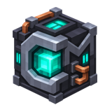

# CeMekanism

<p align="center">
  
</p>

A recreation of Mekanism's industrial gameplay built on **Paper + CraftEngine**. Build machines and factories, and connect production, power, and storage with pipes. Players only need to load the resource pack—no Mekanism mod installation is required.

- **Machines and factories**: Ore processing, parallel production, upgrades, and side configuration. Click a machine's progress bar to browse recipes, click a tag to expand its members, left-click an item to see recipes that produce it, and right-click to see recipes that use it. Navigate between machines and return to previous views.
- **Unified recipe browser**: Use `/mekrecipes` to browse recipes by category, including crafting tables, furnaces, blast furnaces, smokers, campfires, stonecutters, smithing tables, brewing stands, machines, and multiblocks. Vanilla processing recipes include full ingredient details, and the browser is also accessible directly from multiblock interfaces.
- **Automation networks**: Transfer items, fluids, chemicals, energy, and heat.
- **Multiblock structures**: Dynamic Tanks, Thermoelectric Boilers, Industrial Turbines, Induction Matrices, and more.

This project is licensed under AGPLv3, based on mekanism with MIT license.

## Build and Installation

The runtime environment is Paper 26.3 + CraftEngine 26.9.2. Use JDK 21 to build the project.
The plugin depends on `craftMekanism/core` in a sibling directory. Run the following commands from this repository's root:

```bash
(cd ../craftMekanism/core && ./gradlew build)
(cd plugin && ./gradlew build)
```

Copy `plugin/build/libs/ce-mekanism-plugin-0.1.0.jar` into the server's `plugins/` directory,
deploy `pack/` to `plugins/CraftEngine/resources/mek/`, then restart the server and run
`/ce reload all`. Have clients load the resource pack.

## Screenshots

### Automated Production Line


### Machine and Factory Interfaces


### 5× Ore Processing Line


### Fusion and Fission


### Recipe Browser


