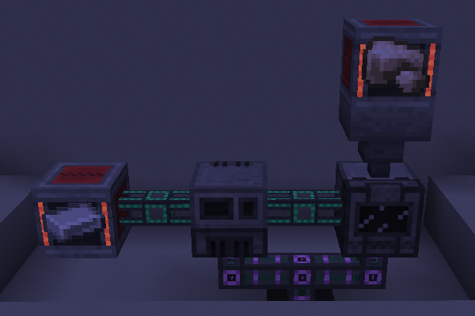
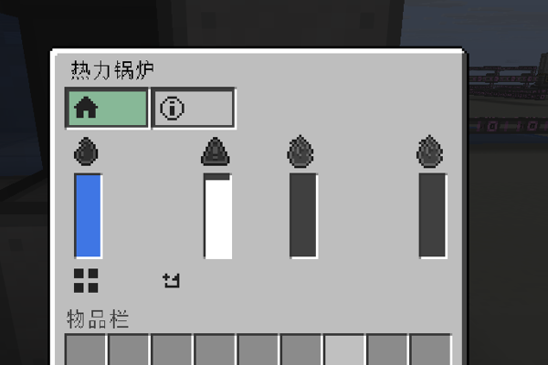
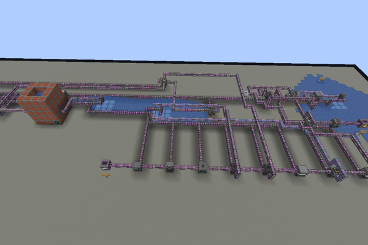
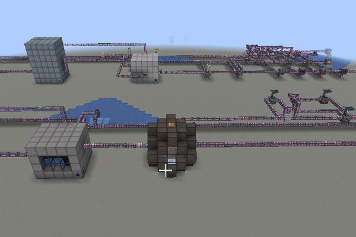
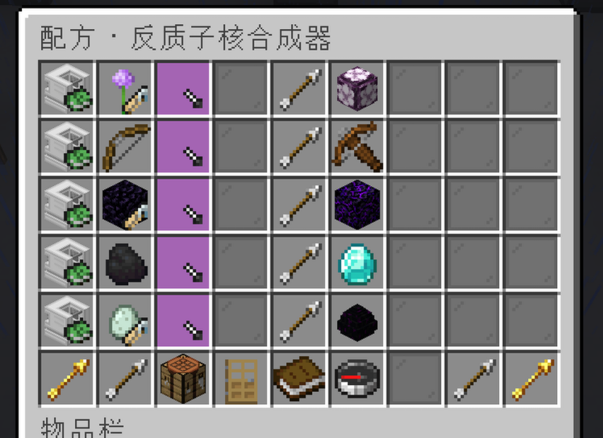

# CeMekanism

基于 **Paper + CraftEngine** 的 Mekanism 工业玩法复刻。建造机器与工厂，用管道连接生产、供能和存储；客户端加载资源包即可游玩，无需安装 Mekanism 模组。

- **机器与工厂**：矿物加工、并行生产、升级与侧面配置；点击机器进度条浏览配方，点击 tag 展开成员，左键物品查来源、右键查用途配方，支持跨机器跳转与返回。
- **统一配方浏览**：`/mekrecipes` 按分类浏览工作台、熔炉、高炉、烟熏炉、营火、切石机、锻造台、酿造台及机器／多方块配方；原版加工支持完整原料详情，多方块面板也可直接进入。
- **自动化网络**：物品、流体、化学品、能量与热量传输。
- **多方块设施**：动态储罐、热力锅炉、工业蒸汽涡轮与感应矩阵等。

项目仍在开发中。

## 构建与安装

运行环境为 Paper 26.3 + CraftEngine 26.9.2，编译使用 JDK 21。
插件依赖同级 `craftMekanism/core`，在本仓库根目录执行：

```bash
(cd ../craftMekanism/core && ./gradlew build)
(cd plugin && ./gradlew build)
```

将 `plugin/build/libs/ce-mekanism-plugin-0.1.0.jar` 放入服务端 `plugins/`，
将 `pack/` 部署为 `plugins/CraftEngine/resources/mek/`，重启服务端后执行
`/ce reload all`，让客户端加载资源包。

## 截图展示

### 自动化产线



### 机器与工厂界面




### 五倍矿产线




### 聚变与裂变




### 配方查询器


